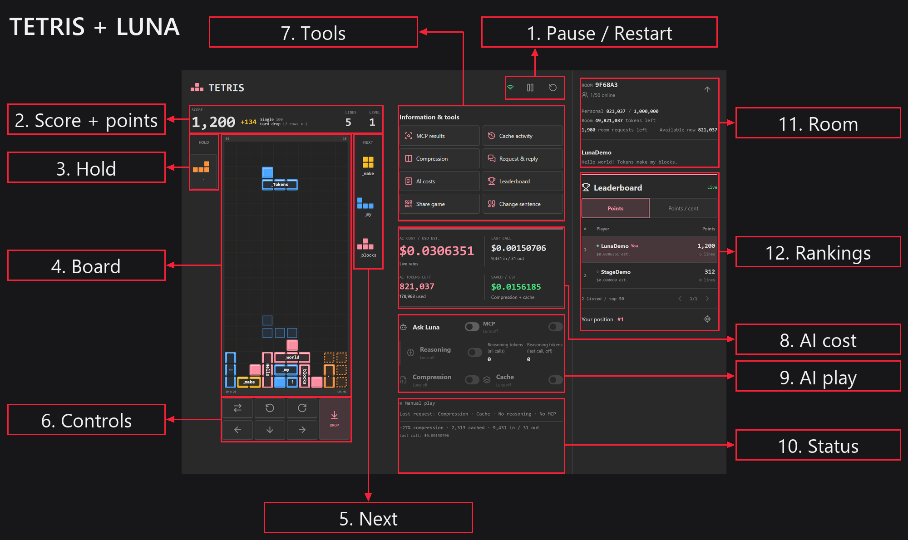
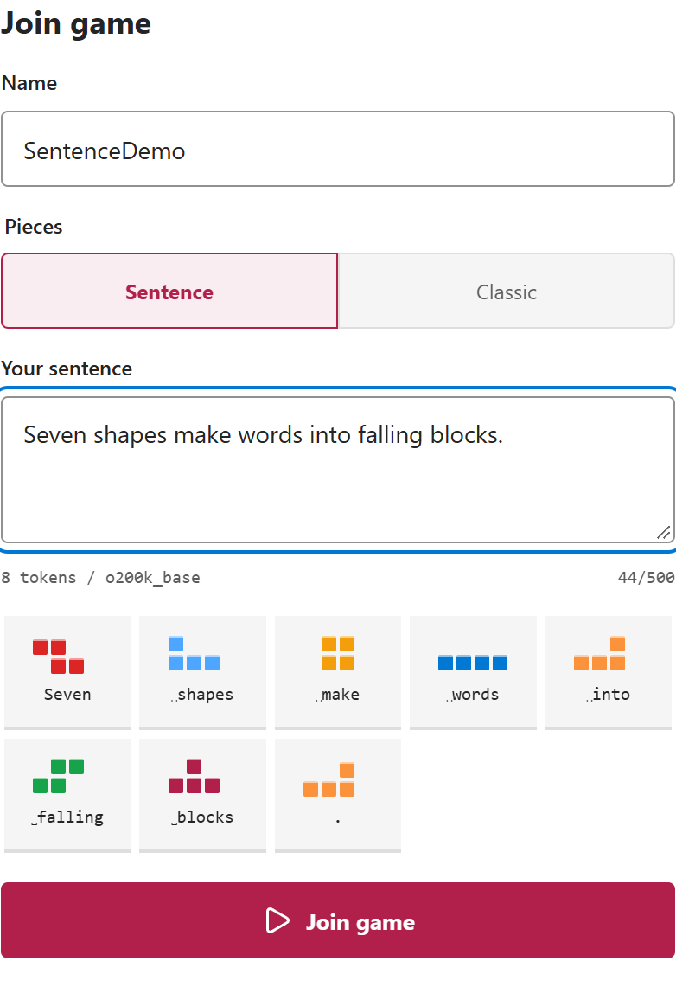
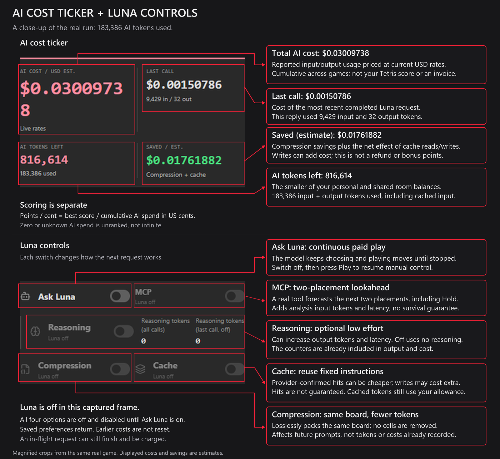
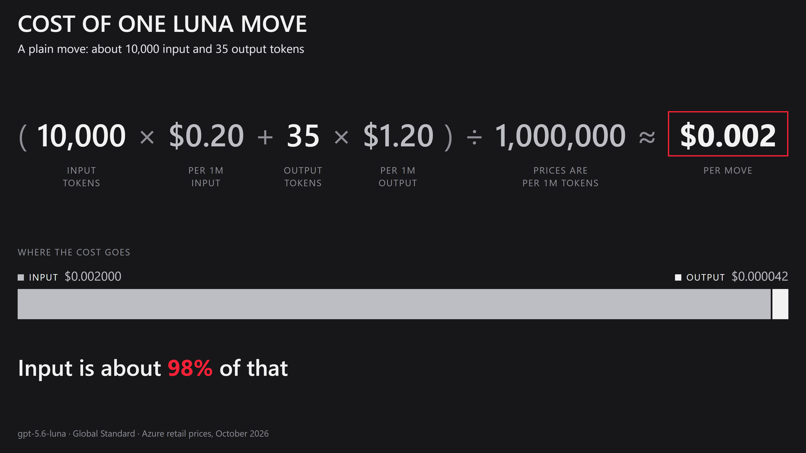
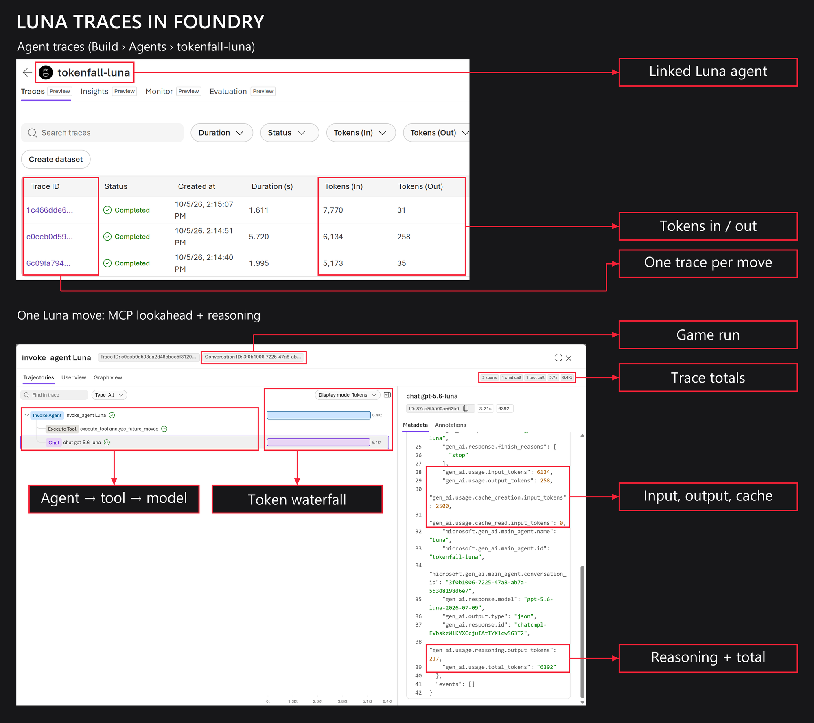

# Tetris With Luna

Tetris with sentence-generated pieces, optional GPT-5.6 Luna play, and shared leaderboards. One TypeScript app runs on Azure Container Apps and asks Microsoft Foundry for Luna's moves.

[Play](https://aka.ms/tokenfall) | [Workshop slides](Slides.pdf)

## Contents

- **Play:** [how to play](#play), [sentence mode](#sentence-mode), [controls](#controls)
- **Luna:** [options](#luna), [request and reply](#request-and-reply), [pricing](#pricing), [cost and speed](#cost-and-speed), [limits and capacity](#limits-and-capacity)
- **Build:** [architecture](#architecture), [`azd up` flow](#infra-flow-azd-up), [one Luna move](#azure-flow-one-luna-move), [run locally](#run-locally), [checks](#checks)
- **Host:** [deploy](#deploy), [admin access](#admin-access), [tracing](#tracing), [reset room data](#reset-room-data)

## Play

Open [the game](https://aka.ms/tokenfall), enter a name (2–16 letters, numbers, spaces, underscores, or hyphens), choose **Sentence** (pieces from your sentence's tokens) or **Classic** (shuffled seven-piece bags), and click **Join game**. Clear full rows; the run ends when a piece can't spawn or locks entirely above the board.

[](docs/images/screen-guide.png)

- **Score:** line clears, back-to-backs, combos, and perfect clears are multiplied by the level (a Tetris is 800 at level 1, 2,400 at level 3). Hard drops add 2 points per row and soft drops 1; the score panel shows what each piece added.
- **Level:** 1 + lines ÷ 10, rounded down. Pieces fall faster each level, from 1 row per second at level 1 until level 20.
- **New game** resets the board, keeps your best score and AI usage, and turns Luna off.
- **Names** aren't accounts: an existing name continues its scores and AI usage, in one tab at a time. **Switch player** pauses and saves your game so someone else can join from the same tab.
- **Rankings** sort by best score or by **Points / cent**, the best score per US cent of AI spend (unranked with zero or incomplete spend). Manual and Luna runs share them.

### Sentence mode

Your text (up to 500 characters and 256 `o200k_base` tokens) becomes a repeating piece queue: each token ID picks a shape by `ID % 7`, so the same text always gives the same queue. Sentences aren't sent to Luna or shown in rankings. **Change sentence** in **Information & tools** starts a new game with new text; it's hidden while Luna plays, so stop Luna first.

| Token ID % 7 | 0 | 1 | 2 | 3 | 4 | 5 | 6 |
| --- | --- | --- | --- | --- | --- | --- | --- |
| Shape | I | O | T | S | Z | J | L |



### Controls

**Left/Right** move · **Down** soft drop · **Space** hard drop · **Up** or **X** rotate clockwise · **Z** rotate counterclockwise · **C** or **Shift** hold, once per piece · **P** or **Escape** pause or resume. Touch controls sit below the board. If keys stop responding after you type in a field, click the board.

## Luna

**Ask Luna makes continuous paid Azure AI requests**; manual play and sentence previews make none. The board pauses during each request, then plays the validated move. To play manually again, turn off **Ask Luna** or click **Stop Luna**, then **Play**; a request in flight may still be charged, but its late move is discarded.

[](docs/images/ai-costs-luna-controls.png)

| Option | Effect |
| --- | --- |
| Reasoning | Low reasoning effort: slower, with more output tokens. [Compare a move with and without it](#request-and-reply). |
| MCP | Two-placement lookahead, including Hold: about 15% more cost and 0.6 s of tool time per move. |
| Compression | Packs the same board into fewer input tokens. |
| Cache | Reuses the instructions when the provider confirms a hit. Writes can cost extra, and hits aren't guaranteed. |

Options start off and apply from the next request. Compression and Cache together cut a move's cost by about half ([cost and speed](#cost-and-speed)). **Information & tools** has the request, compression, cache, MCP, and cost inspectors.

### Request and reply

**Request & reply** in **Information & tools** shows exactly what Luna is sent and returns. It follows each new reply live, or you can pick one of this tab's latest 20 from the **Reply** list. Opening it makes no model call and doesn't pause Luna.

[](docs/images/luna-request-reply.png)

- **Sent to Luna:** the settings (`model`, `reasoning_effort`, `max_completion_tokens`, the strict `tetris_move` schema, the prompt cache key), the system message (the [policy](server/policy.md), plus MCP guidance with MCP on), the user message (board and legal placements), and the full JSON body.
- **Luna's reply:** the `placementId` and tip, finish reason, time, whether the server accepted the move, tokens, cost, and the response body minus the provider's internal routing and latency diagnostics.
- **Reasoning comparison:** **Replay with Reasoning low** (or **off**) resends the request with only `reasoning_effort` and its completion cap changed, and shows both replies side by side with each move's lines, holes, and max height.

**A comparison is a paid Luna request** (about the cost of a move) that's never played but counts toward your AI cost, **Points / cent**, and allowances like any move, and the room's limits apply. Luna's next move waits for it, and each reply is compared once. Luna rewords its tip on every request, even with the same settings, so a different tip alone isn't an effect of reasoning; different placements that leave the same lines, holes, and height are reported as the same result. Reasoning itself can't be shown: Chat Completions returns only a `reasoning_tokens` count, and [reasoning summaries](https://learn.microsoft.com/azure/foundry/openai/how-to/reasoning#reasoning-summary) from the Responses API came back empty for Luna's moves in October 2026 tests, even at medium effort.

### Pricing

Costs are USD estimates at Azure list prices, without discounts or credits. The server loads the rates for `AZURE_LOCATION` from the [Azure Retail Prices API](https://learn.microsoft.com/rest/api/cost-management/retail-prices/azure-retail-prices) at startup and hourly ([pricing](server/pricing.ts)); the cost ticker shows **Live rates**, **Last verified rates** after a failed refresh, or **Rates unavailable** with `--` before any load (for example, without `AZURE_LOCATION`). `gpt-5.6-luna` Global Standard rates, checked October 18, 2026, took effect on August 1, 2026 in East US 2 and are the same in every region that lists them:

| Tokens | Meter (`skuName`) | USD per 1M tokens |
| --- | --- | --- |
| Input | `5.6 luna ShortCo Inp Std Gl` | $0.20 |
| Cached input (cache hit) | `5.6 luna ShortCo Cd Inp Std Gl` | $0.02 |
| Cache write | `5.6 luna ShortCo Cd Wr Std Gl` | $0.25 |
| Output, including reasoning | `5.6 luna ShortCo Opt Std Gl` | $1.20 |

Luna's requests are about 10,000 input tokens, so only these short-context (`ShortCo`), standard (`Std`), Global (`Gl`) meters apply, not `LongCo` long-context (2× input, 1.5× output), `PP` [priority](https://learn.microsoft.com/azure/foundry/openai/concepts/priority-processing) (2×), `Fl` [Flex](https://learn.microsoft.com/azure/foundry/openai/how-to/flex-processing) (half price, slower, sometimes unavailable), or `DZ` Data Zone (+10%) pricing. The server keeps only items with `productName` `Azure OpenAI GPT5`, one of these `skuName` meters, the `AZURE_LOCATION` `armRegionName`, `currencyCode` `USD`, `type` `Consumption` (pay as you go), `unitOfMeasure` `1M`, `isPrimaryMeterRegion` `true`, and `tierMinimumUnits` `0`, then uses the newest `retailPrice` (`unitPrice` is the same) whose `effectiveStartDate` has passed; a missing meter, or conflicting prices with the same start date, fails the refresh. Each token is priced once ([costForUsage](shared/protocol.ts)), since cached and written tokens are part of the input and reasoning tokens part of the output:

```text
cost = ((input − cached − written) × input rate + cached × cached-input rate
        + written × cache-write rate + output × output rate) ÷ 1,000,000
```

A plain move (every option off) uses no cache, so only input and output count:

[](docs/images/luna-move-cost-equation.png)

Input is about 98% of a plain move's cost, so Compression and Cache matter most: each 1,000 input tokens removed saves $0.0002, each 1,000 read from the cache saves $0.00018, and each 1,000 written costs $0.00005 extra. SQLite stores token counts, not dollars, so totals and **Points / cent** follow the current rates. To check your region's rates:

```powershell
$filter = "armRegionName eq 'eastus2' and productName eq 'Azure OpenAI GPT5' and contains(skuName, '5.6 luna ShortCo') and contains(skuName, 'Std Gl')"
(Invoke-RestMethod "https://prices.azure.com/api/retail/prices?currencyCode='USD'&`$filter=$filter").Items | Select-Object skuName, retailPrice, unitOfMeasure, effectiveStartDate
```

### Cost and speed

[](docs/images/luna-cost-vs-speed-explained.png)

Measured in October 2026 from 60 [traces](#tracing), with the six options playing the same 10 board positions at [retail prices](#pricing): Compression and Cache together cost 47% less than Plain at the same speed. Times vary with model load, and Cache lowers the price, not allowance use.

### Limits and capacity

- **Player:** 1,000,000 AI tokens across all games. Input (including cached) and output count, and a new game doesn't refill them.
- **Room:** 50,000,000 AI tokens, 2,000 Luna requests, and up to 250 online players (`ROOM_CAPACITY`, at most 500). Newcomers wait for a free spot, but the host's [admin link](#admin-access) always gets in.
- **Throughput:** at most 80% of the deployment's tokens per minute, 8 Luna calls per second, and 4 MCP lookups at a time. Manual play continues when AI limits run out.
- **Shared Wi-Fi:** per-address limits grow with the room (3 joins and 6 sentence previews per minute per seat), so an audience can share one address.

[](docs/images/luna-capacity-scaling.png)

Measured on Azure in October 2026: a Luna player near East US 2 uses about 310K tokens per minute (allow 430K with the safety margin), the 8 calls per second cap serves about 14 such players at full speed, and with many players on autopilot the room's 2,000 requests last about 5 minutes. One 2 CPU replica held 500 players and 100 spectators, 50 of them on Luna, without restarts or disconnects; input acknowledgements took 2 ms at the median and 35 ms at the 95th percentile, up to 0.6 s during the Luna burst. Player saves are committed together every half second because each SQLite commit on Azure Files takes about 60 ms ([room](server/room.ts)).

Rehearse before an event with the [stress test](scripts/stress-room.ts), run near Azure (for example as a Container Apps job), then [reset the room](#reset-room-data):

```powershell
node scripts/stress-room.ts --url https://your-app --players 500 --spectators 100 --steady-seconds 300 --luna-bots 50 --workers 4
```

## Architecture

A deliberately small TypeScript app that shows the full path from browser game logic to an Azure-hosted model. Each diagram has an editable `.excalidraw` source in [docs/images](docs/images).

[](docs/images/architecture.png)

| Part | Built with | Role |
| --- | --- | --- |
| Browser | React 19, Vite, TypeScript | Draws the board and runs the [shared game engine](shared/game.ts) at 60 FPS. |
| Game server | Node.js 24, Express 5, Socket.IO 4 | One Container Apps replica (2 CPUs, 4 GiB) running the `.ts` files directly: serves the web app, replays every input to verify scores, and admits Luna requests ([room](server/room.ts), [model gateway](server/model.ts)). |
| Local MCP server | MCP TypeScript SDK, stdio | A child process whose read-only `analyze_future_moves` tool simulates the next two placements ([client](server/mcp.ts), [server](server/mcp-server.ts)). |
| SQLite | `node:sqlite` on Azure Files | Players, scores, sentences, allowances, and usage. One writer, so one replica: three replicas corrupted the database in a test. |
| Managed identity | Microsoft Entra ID | Keyless access: `AcrPull` for the image, `Cognitive Services OpenAI User` for Luna, `Monitoring Metrics Publisher` for traces. |
| Microsoft Foundry | `gpt-5.6-luna`, GlobalStandard | Picks one of the legal placements the server sends, as strict JSON. |
| Application Insights | Azure Monitor, OpenTelemetry | One trace per Luna move, kept 30 days. |
| azd | Azure Developer CLI, Bicep, Docker | Builds the image, creates the resources in [infra/](infra/main.bicep), and deploys. |

Zod validates messages and MCP replies, js-tiktoken counts tokens, and prompts are built in [tokens.ts](server/tokens.ts) from the [policy](server/policy.md).

### Infra flow: `azd up`

[](docs/images/infra-flow.png)

The [prepackage hook](azure.yaml) runs `npm ci`, `tsc`, and the Vite build, and azd builds the [Docker image](Dockerfile) (1). [main.bicep](infra/main.bicep) creates [monitoring](infra/monitoring.bicep), the keyless Foundry resource with `gpt-5.6-luna` and the `tokenfall` project ([model](infra/model.bicep)), and the Container App with its managed identity, registry, and Azure Files ([hosting](infra/hosting.bicep)) (2–4). azd pushes the image, and the new revision pulls it with the managed identity, mounts `/data`, and serves once `/api/health` passes (5–7). Provisioning writes the endpoints and Application Insights connection string to `.azure/<env>/.env`, which the local server also reads.

### Azure flow: one Luna move

[](docs/images/azure-flow.png)

Before any paid work, the server checks the browser's `assist` request against cooldowns, budgets, and room capacity (1). With MCP on, a lookahead reply that fails its schema or board hash stops the request before Luna is called (2–3). The managed identity's Entra ID token is cached between moves (4). Luna gets the rules, board, and legal placements and must return a `placementId` and a tip ([request and reply](#request-and-reply)); its rate-limit headers resize the room's limits (5–6). The server accepts only a placement it offered and saves token usage (7), the browser re-checks the placement with the shared engine and plays it (8), and the trace reaches Foundry within minutes (9).

**Luna only picks from legal placements made by deterministic game code, and MCP never plays a move.** Locally, your `az login` replaces the managed identity and `./data` replaces Azure Files.

## Run locally

Requires Node.js 24+, Azure CLI, and `Cognitive Services OpenAI User` on a Luna deployment; the checked-in native frontend packages target Windows x64. Process variables override a root `.env` file, which overrides the selected azd environment ([configuration](server/config.ts)). Without azd:

```powershell
$env:AZURE_OPENAI_ENDPOINT = 'https://YOUR_RESOURCE.openai.azure.com'
$env:AZURE_OPENAI_DEPLOYMENT = 'gpt-5.6-luna'
$env:AZURE_TENANT_ID = 'YOUR_TENANT_ID'
$env:AZURE_LOCATION = 'eastus2' # your resource's region, for pricing
az login --tenant $env:AZURE_TENANT_ID
npm ci
npm --prefix web ci
npm run build
npm start
```

Open http://127.0.0.1:3100. Inference uses your Azure CLI sign-in, so leave `AZURE_CLIENT_ID` unset; it selects managed identity.

- **Development:** `npm run dev` watches the server; rebuild the web app with `npm --prefix web run build`.
- **Data:** SQLite lives in `DATA_DIRECTORY` (default `data`), and boards are lost on restart. A second server needs its own `PORT` and `DATA_DIRECTORY`. Keep databases and backups private.
- **Tracing:** local Luna moves are [traced](#tracing) when `APPLICATIONINSIGHTS_CONNECTION_STRING` is set, as it is in the azd environment; set it empty in `.env` to keep local runs out of the shared traces.
- **Sharing:** set `HOST=0.0.0.0` and an audience-reachable `PUBLIC_BASE_URL`. A `DATA_DIRECTORY/public-url.json` from the [tunnel helper](scripts/start-tunnel.ps1) overrides it; remove the file when the tunnel stops. Check **Share game** before sharing the link.
- **Room size and admin:** `ROOM_CAPACITY` (default 250, at most 500) and `ADMIN_KEY` ([admin access](#admin-access)). On Azure, set them with `azd env set` and provision.

## Checks

```powershell
npm test; npm run build; npm --prefix web run lint; npm run test:ui
```

UI tests require Microsoft Edge. Tests use isolated databases and make no paid calls; the [live evaluator](scripts/evaluate-luna.ts) and [provider smoke checks](scripts/smoke-model.ps1) do.

## Deploy

For a new environment, `azd up` packages, provisions, and deploys ([infra flow](#infra-flow-azd-up)). Packaging needs Docker, PowerShell 7, a signed-in `azd`, and the Windows frontend toolchain.

**Updates need downtime:** SQLite allows one writer, and [Single revision mode overlaps old and new containers](https://learn.microsoft.com/en-us/azure/container-apps/revisions#zero-downtime-deployment).

1. Wait until no players are online and no Luna requests are pending.
2. Set sticky sessions to `none` (`az containerapp ingress sticky-sessions set --affinity none`), switch to **Multiple** revision mode, and deactivate every active revision. Wait for **zero running replicas on every revision**; zero traffic is not enough.
3. Deploy: `azd deploy web --environment tokenfall-dev --no-prompt`.
4. Check for one healthy new replica and no others, route all traffic to it, then restore **Single** revision mode and `--affinity sticky`.

To roll back, stop the new revision and wait for zero replicas before activating the old one. For infrastructure or settings, `azd provision` (and so `azd up`) also starts a new revision: run `azd provision --environment tokenfall-dev --no-prompt` as step 3, check for one healthy replica, then repeat steps 2–4 to deploy. Preview with `azd provision --preview`; `azd deploy` alone doesn't change container settings. Don't run `azd init` over the configured environment, and keep the Azure Files `nobrl` mount and SQLite `DELETE` journaling with full sync. `TRUST_PROXY_HOPS=1` is set for the ingress; leave it unset locally.

## Admin access

The host's admin link joins even a full room and skips the registration and per-address join limits; AI limits still apply. Without a key, admin access is off; after setting one, provision as in [Deploy](#deploy).

```powershell
# 1. Store a random key of at least 32 characters, then provision
azd env set ADMIN_KEY (node -e "console.log(require('crypto').randomBytes(32).toString('base64url'))")
# 2. Before the event, open this link once in the browser you'll present from
"$(azd env get-value SERVICE_WEB_ENDPOINT_URL)/#admin=$(azd env get-value ADMIN_KEY)"
```

The key stays in the URL fragment, which browsers don't send to servers. The page saves it in that browser, removes it from the address bar, and leaves it out of share links. **Admin access is on for this browser** shows before you join, and an **Admin** badge after. Anyone with the key can join a full room, so keep it private. Open `/#admin=` to forget it; to rotate it, set a new value and provision.

## Tracing

[](docs/images/foundry-luna-traces.png)

Each Luna move is one trace ([tracing](server/tracing.ts)) that follows the [OpenTelemetry GenAI conventions](https://opentelemetry.io/docs/specs/semconv/gen-ai/), with the agent ID `tokenfall-luna` and the game run as the conversation ID. Spans record token counts, not prompts or replies; players see those in [Request & reply](#request-and-reply).

| Span | Records |
| --- | --- |
| `invoke_agent Luna` | Options, reserved tokens, move status, and usage; reasoning comparisons are marked `tokenfall.ai.reasoning_replay` |
| `execute_tool analyze_future_moves` | MCP lookahead time and result tokens |
| `chat gpt-5.6-luna` | Response ID, finish reason, and input, output, cache, and reasoning tokens |

The app exports spans with its managed identity to Application Insights, which is connected to the `tokenfall` Foundry project; they arrive within 2–5 minutes and are kept 30 days. Requests rejected before reaching Luna aren't traced, and HTTP auto-instrumentation is off so health probes don't bury the GenAI spans. Provisioning lets the deploying user view them (`Log Analytics Reader`, `Foundry User`).

**Link Luna once per project** in [Microsoft Foundry](https://ai.azure.com): **Build › Agents › New agent › Link external agent**, with the name and OTel agent ID `tokenfall-luna` ([preview](https://learn.microsoft.com/azure/foundry/agents/how-to/register-external-agent)). Traces then appear under **Build › Agents › tokenfall-luna › Traces**; set **Display mode** to **Tokens** for the token waterfall. Hourly usage in Application Insights:

```kusto
dependencies
| where customDimensions["gen_ai.operation.name"] == "chat"
| summarize calls = count(), input = sum(toint(customDimensions["gen_ai.usage.input_tokens"])), output = sum(toint(customDimensions["gen_ai.usage.output_tokens"])) by bin(timestamp, 1h)
```

## Reset room data

**A full reset deletes all players, scores, sentences, sessions, and in-app AI history; everyone must rejoin.** It keeps the room code, verifies a backup first, and doesn't reset Azure billing or provider caches. Preview first, then apply with the room code the preview shows:

```powershell
# Azure: refuses while players are online or Luna requests are pending, then restarts the app
npm run reset:azure
npm run reset:azure -- -Apply -ConfirmRoom YOUR01

# Stopped local server: restart it afterwards
npm run reset -- --database data\tokenfall.sqlite
npm run reset -- --database data\tokenfall.sqlite --apply --confirm-room YOUR01 --server-stopped
```

The [Azure script](scripts/reset-room.ps1) needs PowerShell 7, `az`, `azd`, and Container App exec and restart rights, and defaults to `tokenfall-dev`. Add `-Mode scores` on Azure or `--mode scores` locally to clear only scores, keeping players and AI usage. Never pass `--server-stopped` for a running server. The browser Admin panel (`LOCAL_ROOM_MAINTENANCE=true`) is unauthenticated and runs only on a loopback development server; never expose it through a tunnel.
